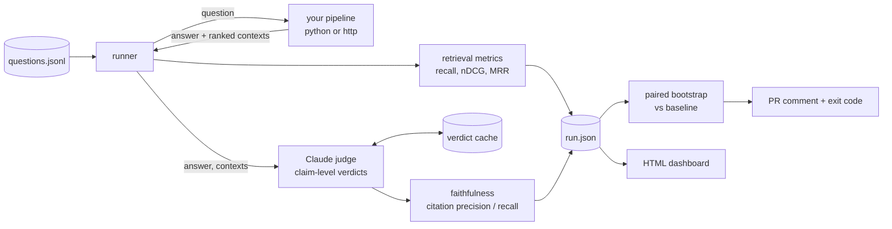
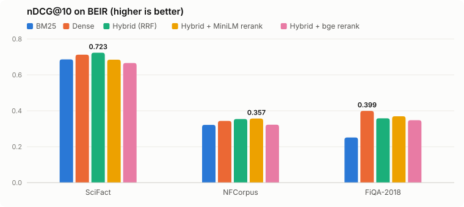

# ragspec: RAG Evaluator

**pytest for RAG.** Point it at any retrieval-augmented generation pipeline and a set of questions. It scores retrieval, checks every claim in every answer against the retrieved sources, and tells you, with confidence intervals, whether a change made things worse. It runs in CI and comments on the pull request.

> **Current status.** The CLI, metrics, comparison, dashboard and retrieval benchmark are tested and measured. Three things are still in progress:
> - The GitHub Action hasn't run on a real pull request yet, and the `v0` tag it references doesn't exist yet.
> - The judge prompt was just revised and hasn't been re-measured.
> - The sample Gemini results in `examples/quickstart` were graded by the earlier prompt. Their faithfulness drop is overstated by judge false alarms; the citation drop is real.

```text
$ ragspec compare runs/scifact-hybrid.json runs/scifact-rerank-minilm.json
 Metric       Base    Head       Δ   95% CI            Status
 recall@1    0.572   0.544  -0.028   -0.072 … +0.016   unchanged
 recall@5    0.770   0.753  -0.017   -0.054 … +0.019   unchanged
 recall@10   0.855   0.808  -0.048   -0.078 … -0.018   regressed
 ndcg@10     0.723   0.685  -0.039   -0.066 … -0.012   regressed
 mrr         0.688   0.653  -0.035   -0.067 … -0.002   regressed
✗ recall@10 dropped -0.048 (95% CI -0.078 to -0.018, n=300)
✗ ndcg@10 dropped -0.039 (95% CI -0.066 to -0.012, n=300)
✗ mrr dropped -0.035 (95% CI -0.067 to -0.002, n=300)
```
<sub>Real output (trimmed): adding a cross-encoder reranker to a hybrid retriever made SciFact retrieval worse, and ragspec says which drops are significant and which are noise.</sub>

## Why

Most RAG projects are judged by trying a few questions by hand. That doesn't catch the PR that "simplifies the prompt" and quietly starts inventing refund policies, or the retriever change that wins on the three questions you tried and loses on forty you didn't. ragspec turns those checks into a test suite:

- **Retrieval metrics** from relevance labels: recall@k, nDCG@k, MRR. Same definitions as TREC/BEIR, so numbers are comparable with published results.
- **Faithfulness**: the answer is split into atomic claims, and each claim is checked against the retrieved contexts by an LLM judge (Claude). Score = supported claims / all claims.
- **Citation accuracy**: for each claim, did the answer cite a source, and does that source actually say it? Reported as citation precision and citation recall.
- **Regression detection**: a paired bootstrap over per-question deltas, so a run is flagged only when a drop is consistent rather than noise from one or two questions.
- **CI**: a GitHub Action that keeps the latest `main` run as the baseline, compares every PR to it, posts a single sticky PR comment, and fails the check on a significant regression.
- **Dashboard**: a self-contained HTML report with run-over-run charts and a per-question drill-down showing the answer, each claim's verdict and the retrieved contexts.

## Quickstart

Requires Python 3.11+ and an API key: Anthropic, or a free hosted one such as Gemini or Groq (see below). A local [Ollama](https://ollama.com) model also works.

```bash
git clone https://github.com/DecodeDebangi/ragspec && cd ragspec
uv sync                                    # or: pip install -e .
export ANTHROPIC_API_KEY=...

cd examples/quickstart
ragspec run -c ragspec.yaml --label main --out main.json            # baseline
ragspec run -c ragspec.pr.yaml --label "PR #1" --baseline main.json \
            --markdown comment.md --report report.html               # a "PR" that regresses
open report.html
```

The quickstart is a 20-article help center for a fictional product, with 26 questions (two of them unanswerable on purpose). `ragspec.pr.yaml` simulates a PR that shortens the prompt, drops the citation rule and retrieves 2 chunks instead of 4 "to cut latency". Comparing it with the baseline shows the regression in the terminal, the PR comment and the report.

### On a free hosted LLM

The judge and the quickstart app both work with any OpenAI-compatible API. These configs use Gemini's free tier ([get a key](https://aistudio.google.com/apikey)):

```bash
cp .env.example .env                       # then put your key in .env as LLM_API_KEY=...

cd examples/quickstart
ragspec run -c ragspec.hosted.yaml --label main --out main.json
ragspec run -c ragspec.hosted.pr.yaml --label "PR #1" --baseline main.json --report report.html
open report.html
```

Rate-limit errors back off and retry, and requests go one at a time because free tiers allow only a few per minute. For Groq or another provider, change `base_url` and `model` in the config. To use a hosted judge on your own pipeline, set this in `ragspec.yaml`:

```yaml
judge:
  provider: openai
  base_url: https://generativelanguage.googleapis.com/v1beta/openai/
  model: gemini-3.5-flash-lite
  concurrency: 1
```

The key is read from `LLM_API_KEY`, either in your shell or in a `.env` file in the working directory or any parent (set `api_key_env` to use another variable). Run `bench/judge_check.py --provider openai --base-url <url> --model <name>` to measure how well a model grades before trusting it.

`gemini-3.5-flash-lite` scored 22/22 on that check in 15 seconds, but on real answers it also rejected correct facts, for example because the documents never name the product. Read a sample of its verdicts before trusting a faithfulness drop.

### Try it in a browser

```bash
cd examples/quickstart
ragspec ui
```

This opens a local playground that listens on localhost only. **Saved results** shows whether a change would be blocked and lets you click through every test question, with no API calls. **Ask a question live** runs a test question or your own through two configs side by side, using one answer and one grading call per config. Give configs friendly names with the optional `label`, `description` and `subject` fields.

### Without an API key: run it locally with Ollama

The judge and the quickstart app can both use a local model served by [Ollama](https://ollama.com) instead of Claude. It costs nothing but is slower, and model size matters a lot. On `bench/judge_check.py`, measured on an 8 GB M2 MacBook:

| Local judge | Expected scores matched | Time for 10 answers |
|---|---|---|
| `qwen2.5:7b` (4.7 GB) | 22 / 22 | ~8 min |
| `qwen2.5:3b` (1.9 GB) | 14 / 22: marks cited claims "supported" without checking them | ~1 min |

Ten hand-written cases are a smoke test, not a benchmark, so treat a local judge as good for trying ragspec out and for development, and use a stronger judge for numbers you publish.

```bash
ollama pull qwen2.5:7b

cd examples/quickstart
ragspec run -c ragspec.ollama.yaml --label main --out main.json
ragspec run -c ragspec.ollama.pr.yaml --label "PR #1" --baseline main.json --report report.html
open report.html
```

To use a local judge on your own pipeline, set `provider: ollama` and a `model` under `judge:` in `ragspec.yaml`. `bench/judge_check.py --provider ollama --model <name>` measures how well a given local model grades.

## Use it on your pipeline

**1. Write questions** as JSONL. `relevant` holds the ids of documents that answer the question, either as a list or as `{id: grade}` for graded relevance. It's optional: questions without it still get faithfulness and citation scores.

```json
{"id": "refund-annual", "question": "Can I get my money back on an annual plan?", "relevant": ["billing-refunds"], "tags": ["billing"]}
```

**2. Expose your pipeline.** Either a Python function:

```python
def answer(question: str) -> dict:
    hits = retriever.search(question, k=5)
    return {
        "answer": llm.answer(question, hits),        # optional: omit for retrieval-only evals
        "contexts": [{"id": h.id, "text": h.text} for h in hits],   # in rank order
    }
```

or an HTTP endpoint:

```yaml
pipeline:
  type: http
  url: http://localhost:8000/ask
  body: {query: "{question}"}
  answer_path: answer
  contexts_path: sources            # list of objects
  context_id_field: doc_id
  context_text_field: content
  headers: {Authorization: "Bearer ${API_TOKEN}"}
```

Citations are read from bracketed markers in the answer: `[doc-17]`, `[doc-17, doc-4]`, or positional `[2]` (= second retrieved context). Set `citations.pattern` for another format.

**3. Configure** with `ragspec init`, which writes a starter `ragspec.yaml`:

```yaml
dataset: evals/questions.jsonl
pipeline:
  target: my_app.rag:answer          # module:function, or module:factory with `options`
k: [1, 5, 10]
judge:
  model: claude-opus-5-5
  effort: medium
gate:
  min: {faithfulness: 0.85}          # absolute floor
  default_max_drop: 0.01             # significant drops smaller than this are tolerated
```

### CLI

| Command | What it does |
| --- | --- |
| `ragspec run [-c ragspec.yaml]` | Evaluate, save a run JSON, print a summary. `--sample N` for a seeded subset, `--tag`, `--no-judge`, `--baseline run.json` to gate, `--markdown`, `--report`. Exits 1 if the gate fails. |
| `ragspec compare BASE HEAD` | Compare two saved runs. Exits 1 on a significant regression. |
| `ragspec report RUNS...` | Build the HTML dashboard from run files or directories. |
| `ragspec ui [FOLDER]` | Open a local playground: run one question through two configs side by side, and browse saved runs. `--port`, `--no-open`. |
| `ragspec init` | Write a starter config and dataset. |

## In CI

```yaml
# .github/workflows/ragspec.yml
on: { push: { branches: [main] }, pull_request: {} }
permissions: { contents: read, actions: read, pull-requests: write }
jobs:
  eval:
    runs-on: ubuntu-latest
    steps:
      - uses: actions/checkout@v4
      - run: pip install -r requirements.txt
      - uses: DecodeDebangi/ragspec@v0
        with:
          args: --sample 100
        env:
          ANTHROPIC_API_KEY: ${{ secrets.ANTHROPIC_API_KEY }}
```

On `main` the run is saved as the baseline artifact. On a PR the action downloads that baseline, compares against it, writes the table to the job summary, posts or updates one PR comment, and uploads the HTML report. Judge verdicts are cached with `actions/cache`, so questions whose answers didn't change cost nothing to re-judge.

The comment ragspec posts looks like this. This one is real: it compares the hybrid retriever (base) with hybrid plus a MiniLM cross-encoder reranker (head) on SciFact.

---

### ragspec: `scifact-rerank-minilm` vs `scifact-hybrid`

❌ **3 gate failures**

- recall@10 dropped -0.048 (95% CI -0.078 to -0.018, n=300)
- ndcg@10 dropped -0.039 (95% CI -0.066 to -0.012, n=300)
- mrr dropped -0.035 (95% CI -0.067 to -0.002, n=300)

| | Metric | Base | Head | Δ | 95% CI | ↑ / ↓ |
|---|---|---:|---:|---:|---|---:|
| ⚪ | recall@1 | 0.572 | 0.544 | -0.028 | -0.072 … +0.016 | 23 / 32 |
| ⚪ | recall@5 | 0.770 | 0.753 | -0.017 | -0.054 … +0.019 | 20 / 22 |
| 🔴 | recall@10 | 0.855 | 0.808 | -0.048 | -0.078 … -0.018 | 8 / 22 |
| ⚪ | ndcg@1 | 0.597 | 0.567 | -0.030 | -0.077 … +0.017 | 23 / 32 |
| ⚪ | ndcg@5 | 0.692 | 0.666 | -0.026 | -0.059 … +0.005 | 45 / 56 |
| 🔴 | ndcg@10 | 0.723 | 0.685 | -0.039 | -0.066 … -0.012 | 46 / 67 |
| 🔴 | mrr | 0.688 | 0.653 | -0.035 | -0.067 … -0.002 | 43 / 63 |
| ⏱ | latency p50 / p95 (ms) | 31 / 36 | 181 / 202 | | | |

<details><summary>Biggest question-level drops (10)</summary>

| Question | Metric | Base | Head |
|---|---|---:|---:|
| `1245` The one-child policy has been successful in lowering population growth. | recall@10 | 1.00 | 0.00 |
| `1280` The ureABIEFGH gene cluster encodes urease maturation proteins : UreD/UreH, UreE, UreF,… | recall@10 | 1.00 | 0.00 |
| `1368` Vitamin D deficiency effects the term of delivery. | recall@10 | 1.00 | 0.00 |
| `239` Cellular aging closely links to an older appearance. | recall@10 | 1.00 | 0.00 |
| `312` De novo assembly of sequence data has more specific contigs than unassembled sequence d… | recall@10 | 1.00 | 0.00 |
| `314` Deamination of cytidine to uridine on the minus strand of viral DNA results in catastro… | recall@10 | 1.00 | 0.00 |
| `384` Epidemiological disease burden from noncommunicable diseases is more prevalent in low e… | recall@10 | 1.00 | 0.00 |
| `415` Female carriers of the Apolipoprotein E4 (APOE4) allele have increased risk for dementia. | recall@10 | 1.00 | 0.00 |
| `517` High levels of copeptin decrease risk of diabetes. | recall@10 | 1.00 | 0.00 |
| `577` In mice, P. chabaudi parasites are able to proliferate faster early in infection when i… | recall@10 | 1.00 | 0.00 |

</details>

<details><summary>Biggest improvements (5)</summary>

| Question | Metric | Base | Head |
|---|---|---:|---:|
| `1049` Ribosomopathies have a low degree of cell and tissue specific pathology. | recall@10 | 0.00 | 1.00 |
| `1200` The binding orientation of the ML-SA1 activator at hTRPML2 is different from the bindin… | recall@10 | 0.00 | 1.00 |
| `1221` The genomic aberrations found in matasteses are very similar to those found in the prim… | recall@10 | 0.00 | 1.00 |
| `775` Mice defective for deoxyribonucleic acid (DNA) polymerase I (polI) reveal increased sen… | recall@10 | 0.00 | 1.00 |
| `1088` Silencing of Bcl2 is important for the maintenance and progression of tumors. | recall@5 | 0.00 | 1.00 |

</details>

<sub>300 questions · 🔴 significant drop · 🟢 significant gain · ↑/↓ = questions that improved/regressed</sub>

---

## How it works



**The judge returns verdicts, not scores.** For each answer, one call to Claude (structured JSON output) returns a list of atomic claims, each with the context ids the answer cited for it, the context ids that support it, a short reason and a verdict (`supported` / `unsupported` / `contradicted`). Scores are then computed in code:

| Metric | Definition |
| --- | --- |
| faithfulness | supported claims ÷ all claims |
| citation precision | cited (claim, context) pairs where that context supports the claim ÷ all cited pairs. Citing a document that was never retrieved counts as wrong. |
| citation recall | supported claims with at least one correct citation ÷ supported claims. An answer with no citations scores 0. |
| abstention rate | share of answers that decline to answer. Reported, not gated, since abstaining is right for unanswerable questions. |

Keeping the arithmetic out of the model makes the scores auditable: every number in the report traces back to claims you can read. The judge's output is also clamped: it can't cite an id that isn't in the answer or support a claim with a context that wasn't retrieved, and a `supported` verdict with no supporting context is downgraded.

**Verdicts are cached** by content hash (judge model + prompt version + question + contexts + answer). Re-running an unchanged pipeline costs nothing and produces identical scores. That determinism is what makes run-to-run comparison in CI meaningful.

**Regressions need evidence.** Only questions present in both runs are compared. For each metric, ragspec bootstraps the mean of per-question deltas (2,000 resamples) and flags a regression only when the whole 95% interval is below zero *and* the drop exceeds `max_drop`. In the PR comment example above, recall@1 fell by 0.028 but its interval crosses zero, so it isn't flagged; recall@10 fell by 0.048 with an interval of −0.078 to −0.018, so it is.

**Checking the judge.** [`bench/judge_check.py`](bench/judge_check.py) runs the judge on ten hand-written answers with known-correct scores: a correct citation, a wrong citation, a changed number, an invented claim, a contradiction, missing citations, positional citations, an abstention, outside knowledge and derived arithmetic. It reports how many expected values the judge reproduces.

## Results

Five retrieval strategies on three [BEIR](https://github.com/beir-cellar/beir) datasets, all test queries (300 SciFact, 323 NFCorpus, 648 FiQA). Every cell is one `ragspec run`; the run files are in [bench/runs](bench/runs). Lexical search is [bm25s](https://github.com/xhluca/bm25s). Dense search is `bge-small-en-v1.5` embeddings in Postgres + pgvector (HNSW). Hybrid fuses the top 100 of each with Reciprocal Rank Fusion. The rerankers rescore hybrid's top 30 with a cross-encoder.



| Retriever | SciFact nDCG@10 | NFCorpus nDCG@10 | FiQA-2018 nDCG@10 | SciFact R@10 | NFCorpus R@10 | FiQA-2018 R@10 | p50 / p95 latency¹ |
|---|---:|---:|---:|---:|---:|---:|---:|
| BM25 | 0.686 | 0.322 | 0.251 | 0.819 | 0.147 | 0.318 | 0.3 / 0.4 ms |
| Dense | 0.713 | 0.344 | **0.399** | 0.836 | 0.162 | 0.459 | 25 / 37 ms |
| Hybrid (RRF) | **0.723** | 0.354 | 0.358 | 0.855 | 0.168 | 0.438 | 30 / 36 ms |
| Hybrid + MiniLM rerank | 0.685 | **0.357** | 0.369 | 0.808 | 0.168 | 0.441 | 181 / 202 ms |
| Hybrid + bge rerank | 0.666 | 0.323 | 0.348 | 0.794 | 0.157 | 0.438 | 1167 / 1603 ms |

¹ Median across datasets of per-query p50 / p95, sequential, MacBook Air M2 (8 GB), models on MPS, Postgres 17 + pgvector HNSW in Docker.

**Sanity check.** BM25 and dense numbers match published BEIR baselines (BM25 NFCorpus 0.322 against the published 0.325, bge-small FiQA 0.399 against about 0.40), so the metric code computes the same thing as the standard tooling.

**What the significance tests say** (`ragspec compare`, paired bootstrap, 95% CI on the change in nDCG@10):

| Change | SciFact | NFCorpus | FiQA |
| --- | --- | --- | --- |
| Dense → Hybrid | +0.011 (−0.011 … +0.032), not significant | +0.011 (−0.003 … +0.025), not significant | **−0.041 (−0.058 … −0.025), regression** |
| Hybrid → + MiniLM rerank | **−0.039 (−0.066 … −0.012), regression** | +0.003 (−0.009 … +0.015), not significant | +0.011 (−0.005 … +0.027), not significant |
| BM25 → Hybrid | | | **+0.107 (+0.092 … +0.123), improvement** |

- **"Hybrid is always better" is not true.** On FiQA (financial forum questions), BM25 is so much weaker than dense retrieval that fusing it in *costs* 0.041 nDCG@10, a significant drop. On the other two datasets hybrid's lead over dense is within noise.
- **Off-the-shelf rerankers didn't pay for themselves.** The MS MARCO MiniLM cross-encoder significantly hurt SciFact, did nothing measurable elsewhere, and added about 150 ms per query. The larger bge reranker scored below hybrid on all three datasets and was about 40× slower on this laptop. Both were trained on web search, which is not scientific claims or finance forums.
- **Averages alone would have misled.** Hybrid's +0.011 on SciFact looks like a win in a table; the interval says it could just as well be −0.011. This is the kind of call ragspec makes in a PR comment.

End-to-end generation results (faithfulness and citations with Claude answers) come from `bench/run_benchmark.py --generate --sample 50`, and the judge's own accuracy from `bench/judge_check.py`. Both need an Anthropic API key and are not in this table yet.

## Trade-offs I made

- **Claims, not a 1–10 rating.** Asking a model "how faithful is this, 1–10?" gives numbers that drift and can't be explained. Claim-level verdicts cost more output tokens but make every score inspectable, and they produce both faithfulness and citation metrics from one call.
- **One judge call per answer, not one per claim.** Per-claim calls are slightly more robust on very long answers but multiply cost and latency by the number of claims. RAG answers are usually short, so one structured call wins.
- **A strong judge by default.** The default judge is Claude Opus 5.5 at medium effort, because a judge that misses unsupported claims makes everything downstream meaningless. It's configurable, and with the cache only changed answers are re-judged.
- **Paired bootstrap over a fixed threshold.** "Fail if faithfulness drops by more than 2 points" either fires on noise with 30 questions or misses real drops with 1,000. A bootstrap CI adapts to the sample size. `max_drop` remains as a floor for "significant but too small to care".
- **Reference-free generation metrics.** ragspec doesn't need gold answers, only optional relevance labels for retrieval. That makes datasets cheap to write; you can grow them from production questions. The cost is that it measures *groundedness*, not *correctness*: a faithful answer to a wrong retrieval scores well on faithfulness and badly on recall, which is why both are reported.
- **Static HTML, no server.** The report is one file with the data embedded. It opens from a CI artifact or GitHub Pages without a backend.

## Limitations and next steps

- Three judge backends: Claude (default), any hosted OpenAI-compatible API, and local models through Ollama. The `Judge` protocol is three lines, so adding others is straightforward.
- Claim splitting is done by the judge, so it's only as consistent as the judge. `judge_check.py` exists to keep an eye on that.
- Next: answer correctness against optional reference answers, per-tag breakdowns in the PR comment, and publishing to PyPI.

## Development

```bash
uv sync --all-extras
uv run pytest            # unit + CLI tests, no API calls (the judge is faked)
uv run ruff check src tests bench
```

Benchmark setup is in [bench/](bench/): `docker compose up -d` (pgvector), `uv run python bench/beir.py scifact nfcorpus fiqa`, then `uv run python bench/run_benchmark.py`.

## License

MIT
